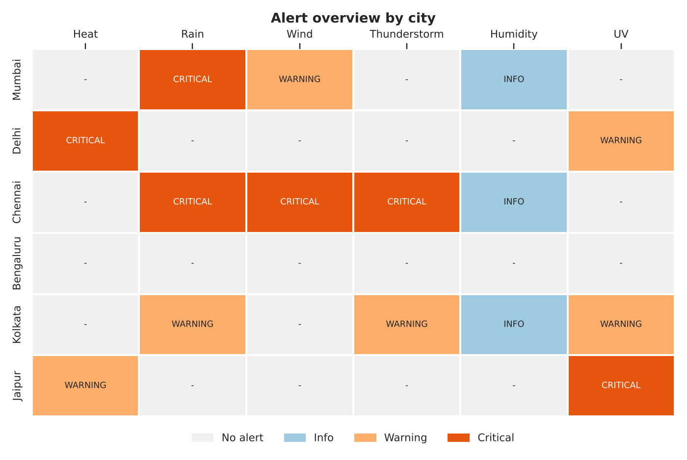
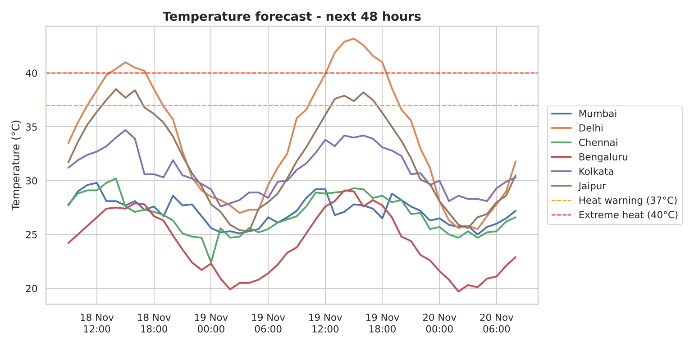
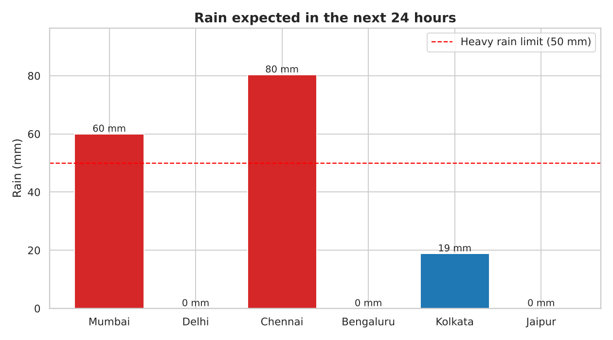
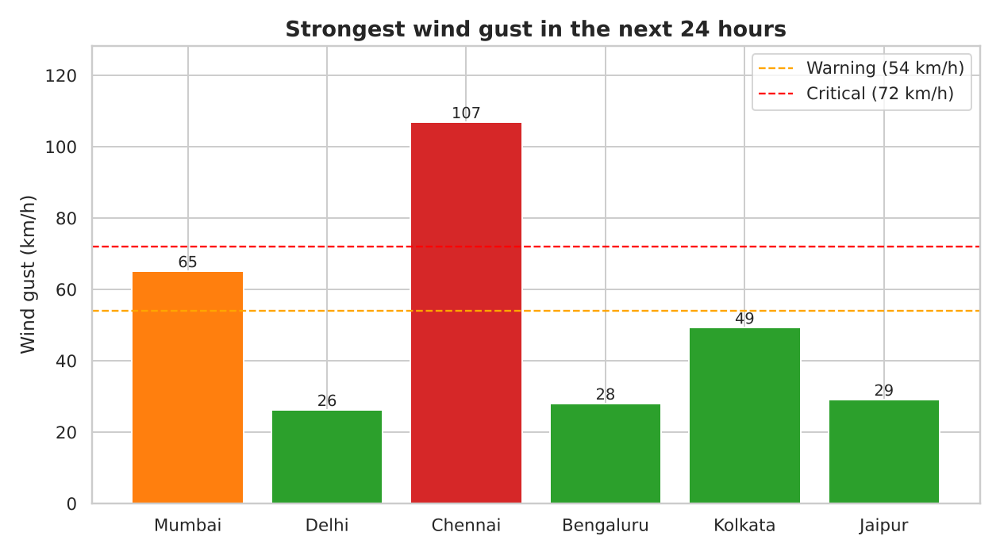
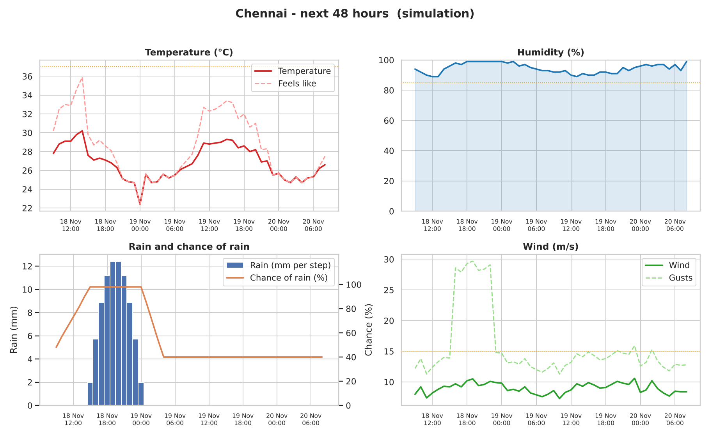

# Weather Forecast & Alert Application

A beginner-friendly Python project that gets weather for one or more cities, converts it into one common
format, checks it against alert rules (heat, rain, wind, thunderstorm, humidity, UV), and creates
a text report, CSV/JSON files and charts. It works **offline in simulation mode** and with **live data**
from Open-Meteo (no key needed) or OpenWeatherMap (free API key). An optional Streamlit dashboard and
optional email alerts are included.

> **Simulation mode uses fake data.** The six sample "city scenarios" are invented weather stories for
> learning and testing. They are not real forecasts and do not describe the real weather in those cities.

## Problem statement

People and teams make better decisions when they are warned in time: carry an umbrella, move an outdoor
event, protect crops, delay a delivery. Raw forecast data is long and technical. This project turns it into
short, clear alerts and simple charts.

## Industry relevance

Logistics, agriculture, energy, travel and event planning all use automated weather alerts to avoid delays,
protect people and reduce costs. The same skills apply to **Python development, API integration, automation
and data analysis**: calling APIs, parsing JSON, cleaning data, applying business rules and reporting.

## Features

- **Simulation mode** (default): works without internet or an API key, and gives identical results every run
- **Live mode** with two providers: Open-Meteo (no key) and OpenWeatherMap (key in `.env`)
- One common data format for every source (deg C, m/s, mm, %), so alert rules are provider-independent
- Alert rules for **heat, rain, wind gusts, thunderstorm, humidity and UV**, with info / warning / critical levels
- Time-window rules (next 12 h, 24 h, 48 h) that work for 1-hour and 3-hour forecasts
- Adjustable thresholds from the command line
- Friendly error messages (no internet, wrong key, unknown city, rate limit); API keys are never printed
- Current weather table, 5-day outlook, forecast summary and alert list
- 5 chart types, including a city-by-alert overview and a 4-panel dashboard per city
- CSV, JSON and text reports
- Optional email alerts (dry run unless configured, no repeated alerts within 12 hours)
- Optional Streamlit dashboard
- 28 automated tests

## Tech stack

Python 3 | requests | JSON | Pandas | NumPy | Matplotlib | Seaborn | datetime | smtplib (optional) | Streamlit (optional)

Developed and tested with Python 3.12, pandas 3.0, matplotlib 3.11 and seaborn 0.13.

## Folder structure

```
Weather-Forecast-Alert-Application/
├── data/                 sample_cities.csv (cities and simulation scenarios)
├── src/
│   ├── config.py         folders, alert thresholds, .env reader
│   ├── models.py         the common WeatherBundle data format
│   ├── simulator.py      fake weather scenarios (no internet needed)
│   ├── providers.py      Open-Meteo and OpenWeatherMap clients and parsers
│   ├── alerts.py         the alert rules
│   ├── analysis.py       summaries and tables
│   ├── visualize.py      charts
│   ├── report.py         CSV, JSON and text report
│   └── notify.py         optional email alerts
├── tests/                28 tests and sample API responses (fixtures)
├── outputs/              generated CSV/JSON files
├── images/               generated charts
├── reports/              generated weather_report.txt
├── docs/                 architecture notes
├── app_streamlit.py      optional dashboard
├── main.py               command-line program
├── .env.example          template for secrets (the real .env is never uploaded)
├── .gitignore
├── requirements.txt
└── README.md
```

## How to run

```bash
# 1. Get the code
git clone <your-repo-url>
cd Weather-Forecast-Alert-Application

# 2. Create and activate a virtual environment
python -m venv .venv
.venv\Scripts\activate          # Windows
source .venv/bin/activate       # Mac / Linux

# 3. Install libraries
pip install -r requirements.txt

# 4. Run in simulation mode (no internet, no key)
python main.py
```

More options:

```bash
python main.py --city Mumbai --city Delhi          # choose simulation cities
python main.py --heat-warn 35 --rain-prob 50       # change alert thresholds
python main.py --mode api --city Pune              # LIVE weather, Open-Meteo, no key
python main.py --mode api --city Pune --city Mumbai
python main.py --mode api --provider openweathermap --city "Pune,IN"    # needs a key
python main.py --notify                            # email warning/critical alerts
streamlit run app_streamlit.py                     # optional dashboard
python -m pytest                                   # run the tests
```

## API setup (OpenWeatherMap, optional)

1. Create a free account at openweathermap.org and copy your API key (a new key can take a while to start working).
2. Copy `.env.example` to `.env` and paste your key: `OPENWEATHER_API_KEY=...`
3. Run `python main.py --mode api --provider openweathermap --city "Pune,IN"`.

**Never upload `.env` to GitHub.** `.gitignore` already excludes it; only `.env.example` is shared.
Open-Meteo needs no key at all, so you can start there.

## Sample output (simulation mode)

```
STEP 1/5  Getting weather data - simulation (fake data, fixed demo clock)
          loaded 6 city/cities: Mumbai, Delhi, Chennai, Bengaluru, Kolkata, Jaipur
STEP 2/5  Current weather
          City            Temp   Feels  Humid     Wind   Condition
          Mumbai         27.7C   29.7C    89%   3.4m/s   Overcast and humid
          Delhi          33.5C   33.5C    23%   2.0m/s   Clear to partly cloudy
          ...
STEP 3/5  Checking alert rules
          [CRITICAL] Mumbai - Heavy rain: About 60 mm of rain expected in the next 24 h (limit 50 mm), ...
          [WARNING] Mumbai - Strong wind gusts: Gusts up to 18.1 m/s (65 km/h) around 18 Nov 18:00 ...
          [CRITICAL] Delhi - Extreme heat: Temperature expected to reach 43.2C around 19 Nov 15:00 ...
          [CRITICAL] Chennai - Thunderstorm expected: About 6 h of thunderstorm in the next 24 h ...
          ...
DONE. 15 alert(s): 6 critical, 6 warning, 3 info.
```

Bengaluru has no alerts, which shows the rules do not fire when the weather is calm.
See the full report in [`reports/weather_report.txt`](reports/weather_report.txt).

## Screenshots

| Alert overview | Temperature forecast |
|---|---|
|  |  |

| Rain in next 24 h | Wind gusts |
|---|---|
|  |  |



## How the alerts work

| Alert | Looks at | Warning | Critical |
|---|---|---|---|
| Heat | next 48 h, max temperature | 37 C | 40 C |
| Rain | next 12 h chance / next 24 h total | chance 60% | 50 mm |
| Wind gusts | next 24 h | 15 m/s | 20 m/s |
| Thunderstorm | next 24 h | any | 3 h or more |
| Humidity | next 12 h average | info at 85% | - |
| UV index | rest of today | 8 | 11 |

All limits are in `src/config.py` and can be changed.

## Limitations and notes

- OpenWeatherMap's free forecast has no UV index, so there are no UV alerts in that mode.
- Simulation uses a fixed demo clock (18 Nov 2026, 09:00) so results never change; live modes use the city's real local time.
- Email sending depends on your provider's settings (Gmail needs an app password).
- Weather alerts here are for learning. For safety decisions, follow official weather agencies.

## Learning outcomes

- Calling web APIs with `requests`, with retries and error handling
- Parsing and normalising JSON from different services (units, time zones, missing values)
- Designing a rule engine with severity levels
- Keeping secrets out of GitHub with `.env` and `.gitignore`
- Testing without internet using sample responses
- Building charts and reports with Pandas and Matplotlib
- Structuring a project into small modules and documenting it for GitHub

## Future improvements

Maps, air-quality (AQI) alerts, Telegram/SMS notifications, a database of past alerts,
scheduled runs, and combining several weather providers.
